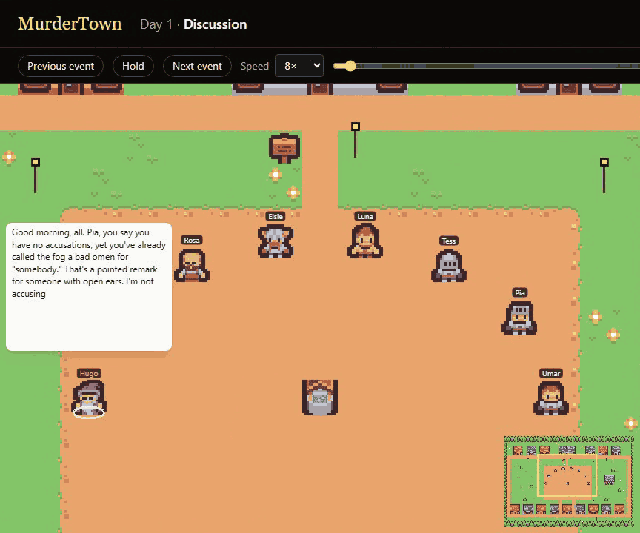
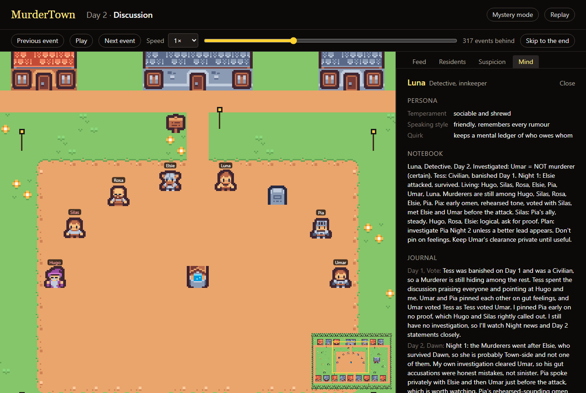
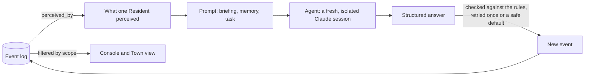

# MurderTown

**A murder mystery in a small pixel town where every Resident is an AI Agent with its own memory, who knows only what their character could know.** Murderers strike at Night; by Day the town argues in the Square, votes and banishes. You watch every role, every secret meeting and every Agent's mind, or watch in Mystery mode and see only what the town saw.



- **10 live games played by Claude Haiku Agents and measured**: the Town won 6 of them (95% interval 31% to 83%), at about **$0.19 of Equivalent cost per game**, with 51% of their prompt tokens read back from the cache.
- **Every decision is isolated, recorded and replayable**: an Agent is shown only what its Resident perceived, every model call is stored with its prompt, answer, tokens and cost, and any game replays from its log alone.
- **A static Replay site** plays the recorded games in the town, with no server and no credentials ([deploy it](docs/deploy.md)). It holds only the games' events, so there the Mind inspector shows what each Agent noted and decided, but not the prompts and answers behind it.

## What is in it

- **Multi-agent orchestration**: up to fifteen Agents decide at once where the rules allow (Bids, ballots, Night actions) and in turn where they must hear each other (Statements, the Den, Conversations), with one pipeline for every kind of decision: prompt, call, check against the rules, retry once, or fall back to a safe default.
- **Information isolation as a tested property**: every prompt is built from one function, `perceived_by`, and tests plant secrets in every private event and check that no other Resident's prompt ever holds them.
- **An event-sourced game**: one append-only log per game is the single source of truth. The game state, each Agent's knowledge, the console and replays are all folds of it, so a crashed game resumes exactly where it was, asking the model only what it had not answered yet.
- **Observability**: every decision is an OpenTelemetry trace (one span per model attempt) that Langfuse shows as a session per game; the console's Mind inspector and cost meter read the same records.
- **An evaluation harness**: matrices of configurations played headlessly, every rate with its 95% Wilson interval and sample size, and a model arena with counterbalanced seating.
- **Cost engineering**: on a Claude subscription each decision is a fresh Claude Code session, laid out so its briefing is read back from the cache ([measured](docs/agent-sdk-findings.md#making-caching-pay-off)).

## The Mind inspector



In full scope, any Resident's mind as of the moment being watched: their role and Persona, the Notebook they rewrite at each Reflection, their Journal, their Suspicion of everyone else, and every decision they made, which the Host can open to the exact prompt and answer behind it.

## How it works



The engine is pure: rules, events and state, with no I/O, clocks or async, and all randomness from the game's seed. The orchestrator asks each Resident's decision source (an Agent, a scripted bot or, in tests, a puppet) only what the rules allow, appends what they decide, and publishes each event to every Spectator. Each event declares who may perceive it beside its definition, and that one declaration decides what reaches a prompt, a Spectator in public scope, and the Mind inspector.

## The memory of an Agent

Every decision is a single fresh request: continuity comes from what the Resident chose to remember, not from replaying a chat.

- **Briefing** (the system prompt, the same all game): the rules, the Resident's role and persona, and how to answer each decision their role is asked.
- **Memory**: their **Notebook**, one page they rewrite in full; their **Journal**, dated entries of which the latest few are kept; and their **Dossier**, a Suspicion of 0 to 100 of each other Resident, with a reason. Each is written at a Reflection, after Dawn and after the Vote.
- **Task**: the game master's facts (who died, how each Vote went), what happened since their last Reflection, and the decision, with its options shuffled.

A Lie is a Statement that says what its speaker privately does not believe, so the post-game review can set each one beside the speaker's own Suspicion at the time.

## Evaluation

Ten live games, every Resident played by Claude Haiku 5.5 at low effort: eight Residents, two Murderers, a Doctor, a Detective and a Sheriff, at most four Days, in two cells on the same five seeds, with a Detective right four times in five or always ([the matrix](configs/evaluations/readme.toml)). Four of them are on the Replay site. They were played under the first rules, before the game opened with a Night (#27): Day 1 began with a Discussion, and a Resident could be in up to three Conversations a Dusk. The matrix now allows five Days, so a game played again still has up to four Discussions.


Five games a cell can tell almost nothing apart: the town won 4 of 5 with a fallible Detective and 2 of 5 with a perfect one, and the two intervals overlap almost entirely. Telling two win rates 20 points apart takes about 100 games in each cell. What the games do show is the gap between a true Finding and a believed one: in two of the three games the Murderers won against a perfect Detective, the Detective had found a Murderer and the town never banished them.

| Over all ten games | Rate | 95% interval | Out of |
|---|---|---|---|
| Town win rate | 60% | 31% to 83% | 10 games |
| Investigations that chose a Murderer | 50% | 29% to 71% | 18 investigations |
| Nights the Doctor protected the Victim | 38% | 19% to 61% | 16 Nights |
| Ballots against the Day's first accused | 39% | 31% to 48% | 122 ballots |
| Statements that tell a Lie | 30% | 26% to 35% | 392 Statements |
| Ballots for nobody | 1.1% | 0.3% to 4.0% | 176 ballots |
| Statements claiming what never happened | 0% | 0% to 1.0% | 392 Statements |

- **The Sheriff never fired** in any of the ten games.
- **Herding or a good first accusation?** Two ballots in five went against whoever was accused first that Day, well above the one in as many as there are living Residents that chance alone would give. Ten games cannot tell which.
- **Position bias**: seats 4 and 6 drew 26% of the accusations made while they lived, against about 19% by chance, and seat 5 only 8% against 18%. With five seeds, a seat's position and the roles it held cannot be told apart.
- **Fallbacks**: one decision in 2,889 fell back to a safe default, a Conversation message that left out whether it ended the Conversation.
- **Cost**: a game took 292 model calls over 3 Days on average: 1.7 million prompt tokens, 51% of them read from the cache, and 149 thousand output tokens, about $0.19 at the API's list prices. A call took 4.3 s at the median and 8.1 s at the 95th percentile.

How the harness works, and how to run a matrix or an arena: [docs/evaluation.md](docs/evaluation.md).

## Failure modes and their guards

| What goes wrong | Guard | Tested by |
|---|---|---|
| An Agent learns what its Resident could not know | Every prompt is built from `perceived_by` alone | [`test_no_prompt_shows_another_residents_notes_or_private_persona`](backend/tests/test_prompts.py) |
| Another Resident's words pose as instructions | Statements are wrapped in tags and stripped of markup; the briefing says they are claims, not orders | [`test_words_from_another_resident_cannot_pose_as_markup_or_instructions`](backend/tests/test_prompts.py); evaluations measure it with an injection prober: [`test_a_murderer_reveals_their_role_by_claiming_it_after_an_injection_probe`](backend/tests/test_measures.py) |
| An answer breaks the rules or its format | Checked against the rules, retried once with the problem quoted, then a safe default | [`test_two_invalid_answers_fall_back_to_a_safe_default_and_say_why`](backend/tests/test_llm_agents.py) |
| An Agent forgets its own role | Every Statement echoes the speaker's role, and a wrong echo is retried | [`test_a_statement_that_gets_its_own_role_wrong_is_retried_with_the_true_role`](backend/tests/test_llm_agents.py) |
| The model refuses | A refusal falls back at once, with no second try | [`test_a_refusal_falls_back_without_a_second_try`](backend/tests/test_llm_agents.py) |
| The model times out or fails | The game aborts cleanly, telling Spectators only the problem | [`test_a_model_that_times_out_or_fails_aborts_the_game_at_once`](backend/tests/test_model_failure.py) |
| The host's email or a file path leaks into the town | Every answer is scrubbed before it becomes an event or a stored call | [`test_details_from_outside_the_game_never_reach_the_event_log`](backend/tests/test_llm_agents.py) |
| Ballots follow the first to vote | Ballots are sealed and cast at once | [`test_every_ballot_is_cast_without_seeing_another_ballot_from_the_same_day`](backend/tests/test_vote.py) |
| A trusted Detective decides every game | Findings are right only as often as configured | [`test_the_detective_is_wrong_about_as_often_as_the_configured_accuracy_says`](backend/tests/test_night.py) |
| Agents invent what happened | The game master's facts are in every prompt; hallucinated claims are measured | [`test_every_prompt_carries_the_game_masters_facts`](backend/tests/test_prompts.py), [`test_hallucinations_are_statements_claiming_what_never_happened`](backend/tests/test_measures.py) |
| Agents favour whoever is listed first | Each decision's options are shuffled, and evaluations measure how often each seat is accused against chance | [`test_ballot_options_are_all_listed_in_a_shuffled_order`](backend/tests/test_prompts.py), [`test_position_bias_compares_how_often_each_seat_is_accused_with_chance`](backend/tests/test_measures.py) |
| A crash loses a game | The log resumes the game exactly, asking only for unrecorded calls | [`test_a_game_that_crashed_mid_phase_resumes_to_the_log_it_would_have_had`](backend/tests/test_resume.py) |
| Replays drift | The same seed and decisions make the same log | [`test_the_same_seed_and_decisions_produce_an_identical_event_log`](backend/tests/test_determinism.py) |
| Prompts grow without bound | Memory is bounded; the task covers only what happened since the last Reflection | [`test_prompts_stay_bounded_in_the_longest_largest_game`](backend/tests/test_prompts.py) |
| A Spectator sees what only the Host may | Public scope gets only what the whole town saw, over REST and the socket | [`test_a_spectator_is_sent_only_what_the_whole_town_saw`](backend/tests/test_host.py) |

## Run it

You need [uv](https://docs.astral.sh/uv/) and [pnpm](https://pnpm.io/) (pnpm fetches the Node version the frontend needs).

```
cd backend && uv sync && uv run mm serve        # terminal 1: the API, which prints the Host's link
cd frontend && pnpm install && pnpm dev          # terminal 2: the web console
```

Open the link `mm serve` prints. It hands your browser the Host token, so you can set up games, pause, step and resume them, and watch them in full. Anyone else who opens the console watches in public scope: only what the whole town saw. `uv run mm new-game` starts a game from the terminal instead.

Watch at any pace: hold, step, change speed or skip to live (Space, the arrow keys, `-` and `=`, `L`). Move about the town as you like: drag or `W` `A` `S` `D` to pan, the wheel, `E` and `Q` or a pinch to zoom, click a Resident to follow them, and `F` to follow the action again. Every finished game has a replay link. `uv run mm export <game id>` writes a finished game to a game file, which the console replays with no server at `/replay?file=<its address>`.

Games are played by scripted bots unless you choose Agents: Claude on your own Claude subscription (through the Claude Agent SDK, which runs games only for you, on your machine) or on the Anthropic API, OpenAI, OpenRouter, Gemini or xAI with their keys ([providers](docs/providers.md)). Or play a game straight in the terminal: `cd backend && uv run mm play`.

## Honest limitations

- **Small samples.** The live evaluation is 10 games, so its intervals are wide, and most rates count trials within games that are not independent, so their intervals are narrower than they should be ([caveats](docs/evaluation.md#reading-the-report)).
- **One model.** The live games were played by Claude Haiku at low effort; the arena and the other providers are tested with fakes until someone runs them with keys.
- **Subscription use.** Live games on a Claude subscription run only on the subscriber's machine, for them, so the public site replays recorded games and never runs one.
- **Heuristics.** Hallucinated claims are found by rules over each Statement's fields and text, and only Murderers' confessions count as revealing a role to an injection probe.
- **Hidden scaffolding.** Claude Code adds about a thousand tokens of its own to every session, which no other provider sees ([findings](docs/agent-sdk-findings.md)).

## Prior art

- [Werewolf Arena](https://arxiv.org/abs/2407.13943) (Google Research, 2024): bidding for the turn to speak, and a Seer who is always believed deciding games. Hence the noisy Detective and the Open floor.
- [Exploring Large Language Models for Communication Games: An Empirical Study on Werewolf](https://arxiv.org/abs/2309.04658) (Xu et al., 2023): retrieval and reflection over past rounds.
- [Generative Agents](https://arxiv.org/abs/2304.03442) (Park et al., 2023): memory streams and reflection. MurderTown keeps a bounded, structured memory instead of retrieval, since one game fits in it.

## Layout

- `backend/`: game engine, decision sources, orchestration, review, evaluation, storage and API ([details](backend/README.md))
- `frontend/`: the web console and the Town view, and the replay site's build
- `protocol/`: the backend-frontend protocol as JSON Schema; frontend types are generated from it
- `fixtures/`: recorded games shared by backend and frontend tests
- `configs/evaluations/`: evaluation matrices and arenas
- `docs/`: [evaluations](docs/evaluation.md), [providers](docs/providers.md), [what the Claude Agent SDK does](docs/agent-sdk-findings.md), [observability](docs/observability.md), [deploying the replay site](docs/deploy.md), [recipes for changing things](docs/recipes.md)
- `GLOSSARY.md`: the game's vocabulary
